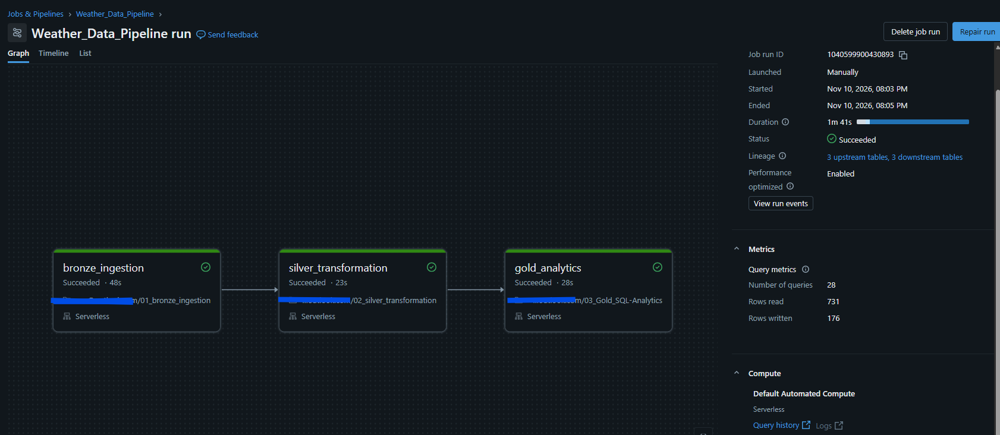

# Weather Data Engineering Pipeline

An end-to-end data engineering project built using Python, SQL, PySpark, Delta Lake, and Azure Databricks.

The pipeline retrieves historical weather observations from the Open-Meteo API, processes them through a Medallion Architecture (Bronze, Silver, Gold), and prepares aggregated datasets for analytics and visualization.

## Architecture

**Open-Meteo API → Python Ingestion → Bronze Delta → Silver PySpark → Gold SQL → Databricks Dashboard**

### Bronze Layer — Data Ingestion
- Retrieves the previous seven complete days of weather observations using Python and the Open-Meteo REST API.
- Stores the raw JSON response in a Databricks Unity Catalog volume.
- Loads the JSON into a Bronze Delta table.

### Silver Layer — Data Transformation
- Reads the Bronze Delta table using PySpark.
- Flattens nested hourly weather observations into structured records.
- Converts timestamps and standardizes column names.
- Performs null checks, removes duplicate observations, and filters missing timestamps.
- Writes cleaned records into a Silver Delta table.

### Gold Layer — SQL Analytics
- Aggregates hourly observations into daily weather summaries.
- Calculates average temperature, humidity, wind speed, and total precipitation.
- Uses SQL window functions, including `RANK()` and `LAG()`, to analyze temperature patterns.
- Performs data-quality checks for null values, duplicate dates, and record counts.
- Creates a Gold Delta table for reporting.

## Technologies

| Technology | Application |
|---|---|
| Python | REST API ingestion and JSON processing |
| PySpark | Data transformation and validation |
| SQL | Aggregations, analytics, and data-quality checks |
| Azure Databricks | Data processing and workflow orchestration |
| Delta Lake | Bronze, Silver, and Gold table storage |
| Unity Catalog | Data organization and management |
| Databricks Workflows | Automated task dependencies and execution |
| Databricks Dashboards | Weather analytics visualization |

## Workflow Orchestration

The pipeline uses a Databricks Lakeflow Job with three dependent tasks:

1. `bronze_ingestion`
2. `silver_transformation`
3. `gold_analytics`

The workflow is configured for daily execution at **7:30 AM Eastern**, refreshing the dataset with the previous seven complete days of weather observations.

Each run replaces the existing Bronze, Silver, and Gold datasets rather than accumulating historical records.

### Successful Pipeline Execution



A successful execution completed all three stages in **1 minute and 41 seconds**.

## Analytics Dashboard

The Databricks dashboard visualizes four weather measurements:

- Temperature
- Relative humidity
- Precipitation
- Wind speed

The dashboard provides a visual summary of the weather data processed through the pipeline.

**[View Dashboard PDF](dashboard/weather_dashboard.pdf)**

## Repository Structure

```text
weather-data-pipeline/
├── ingestion/
│   └── fetch_weather.py
├── notebooks/
│   ├── 01_bronze_ingestion.py
│   ├── 02_silver_transformation.py
│   └── 03_Gold_SQL-Analytics.py
├── workflows/
│   ├── weather_pipeline_job.json
│   └── workflow_screenshot.png
├── dashboard/
│   └── weather_dashboard.pdf
└── README.md
```

## Project Outcome

This project demonstrates practical experience building an end-to-end data pipeline, including:

- REST API integration and JSON ingestion.
- PySpark transformations and data cleansing.
- SQL analytics and data validation.
- Delta Lake storage using Medallion Architecture.
- Workflow orchestration with task dependencies.
- Dashboard development and reporting.

The result is a functioning data engineering pipeline that processes weather observations into analytics-ready datasets.
